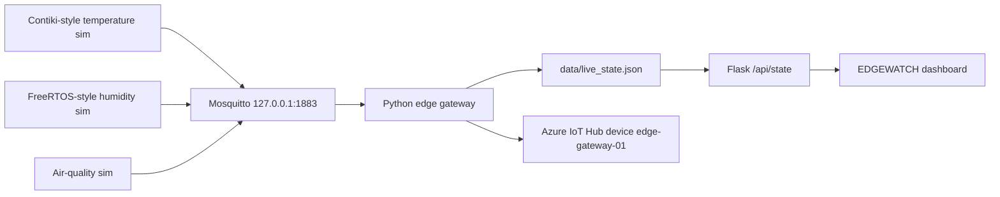

# EDGEWATCH

Interoperable IoT monitoring for mixed device message formats. Simulated sensors publish their own JSON over MQTT. A Python edge gateway validates and normalizes every message, then forwards one common document to Azure IoT Hub. A live dashboard shows local reception and cloud forwarding as separate statuses.

This is an Applied Edge Analytics prototype. The Contiki-NG and FreeRTOS programs are **Python simulations inspired by those systems**. They do not boot those kernels. A new device can appear on the same dashboard without a frontend change.

## Problem

Devices that would run different lightweight operating systems do not share a payload shape. A temperature node might send `node_id` and `temp_c`. A humidity task might send `deviceId`, `value`, and `unit`. The monitoring screen should not be rewritten for each device.

EDGEWATCH puts the translation at the edge. The gateway is the only component that understands native field names. The dashboard and the cloud payload use one schema.

## Tech stack

| Layer | Technology |
| --- | --- |
| Device simulations | Python 3.10+ |
| Local broker | Mosquitto, localhost only |
| MQTT client | Paho MQTT 1.6 (required by the Azure SDK) |
| Edge gateway | Python |
| Cloud | Azure IoT Hub, device identity `edge-gateway-01` |
| Cloud SDK | `azure-iot-device` |
| Dashboard API | Flask |
| Dashboard UI | HTML, CSS, vanilla JavaScript |
| Charts | Chart.js 4 |
| Tests | pytest |
| Payloads | JSON |
| State | In-memory snapshot written to `data/live_state.json` |

Not used: React, Node.js, Docker, a database, machine learning, or any Azure service besides IoT Hub.

## System architecture

Simulators publish to Mosquitto. The gateway subscribes to `devices/+/telemetry`, normalizes the JSON, updates a local state file, and sends a copy to IoT Hub. Flask reads that file. The browser polls `GET /api/state` every 2.5 seconds. The dashboard does not read telemetry back from Azure.




The cloud arrow is one way. `send_message` returning means the device SDK finished the call. Confirm the body in Azure IoT Explorer or the VS Code IoT Hub monitor.

More detail is in [architecture.md](architecture.md).

## Data flow


Native messages stay on MQTT. After the gateway, every device uses the same top-level document:

```json
{
  "device_id": "contiki-01",
  "device_type": "temperature_sensor",
  "timestamp": "2026-10-20T16:37:44.159Z",
  "readings": { "temperature_c": 29.4, "battery_mv": 3112 },
  "metadata": { "source_format": "contiki_native" }
}
```

| Simulator | MQTT topic | Native fields | Normalized readings |
| --- | --- | --- | --- |
| Contiki-style temperature | `devices/contiki-01/telemetry` | `node_id`, `temp_c`, `battery_mv` | `temperature_c`, `battery_mv` |
| FreeRTOS-style humidity | `devices/freertos-01/telemetry` | `deviceId`, `sensor`, `value`, `unit` | `humidity_percent` |
| Air-quality | `devices/airquality-01/telemetry` | `sensorId`, `pm25`, `pm10` | `pm25_ug_m3`, `pm10_ug_m3` |

Invalid JSON and missing fields are counted, shown in the activity list, and not forwarded.

## How the edge layer works

On each MQTT message the gateway:

1. Parses JSON. A bad payload is counted as invalid and dropped.
2. Checks the required fields for that native shape.
3. Renames fields into the common schema and adds a UTC timestamp.
4. Stores the device, a short history, and a rolling average of the latest five temperature readings.
5. Forwards the normalized document with the Azure IoT device SDK, or with a clearly labeled mock sender when no device connection string is configured.

Processing time is the local work before the send call. Forward time is only the sender call. Those numbers are not Azure portal ingestion time.

## Run from scratch on Windows

Use PowerShell. Python 3.10 or newer is required.

### 1. Clone and enter the project

```powershell
git clone https://github.com/Sudesh-J/EDGEWATCH.git
cd EDGEWATCH
py -3 --version
```

### 2. Create a virtual environment and install packages

```powershell
py -3 -m venv .venv
Set-ExecutionPolicy -Scope Process -ExecutionPolicy Bypass
.\.venv\Scripts\Activate.ps1
python -m pip install -r requirements.txt
```

`azure-iot-device` 2.14 needs Paho MQTT 1.6, so requirements pin Paho below version 2.

### 3. Install Mosquitto

Skip this if Mosquitto is already installed.

```powershell
winget install --id EclipseFoundation.Mosquitto -e --accept-package-agreements --accept-source-agreements
```

The broker must listen on localhost only. Do not port-forward it. The Eclipse installer starts a Windows service on `127.0.0.1:1883`. Confirm it:

```powershell
Get-NetTCPConnection -LocalPort 1883 -ErrorAction SilentlyContinue
```

If nothing is listening, start the included config and leave that window open:

```powershell
mosquitto -c mosquitto\mosquitto.local.conf -v
```

### 4. Configure Azure, or stay in mock mode

Copy the example environment file:

```powershell
copy .env.example .env
```

Mock mode needs no cloud account. Leave `IOTHUB_DEVICE_CONNECTION_STRING` empty and set `AZURE_MODE=mock` or `AZURE_MODE=auto`. Mock sends are counted on the dashboard and are not delivered to IoT Hub.

For a real hub, in the Azure Portal:

1. Open the existing IoT Hub.
2. Go to **Device management → Devices → Add device**.
3. Set the device ID to `edge-gateway-01`.
4. Save, open the device, and copy the **Primary connection string**.
5. Paste it into `.env` as `IOTHUB_DEVICE_CONNECTION_STRING`.
6. Set `AZURE_MODE=live`.

Use the device connection string, not the IoT Hub service or `iothubowner` string. `.env` is gitignored. The gateway does not print the key.

### 5. Start the processes

Use a separate PowerShell window for each process. Activate `.venv` in each window.

**Terminal 1 — broker.** Already covered above. Reuse the service if port 1883 is open on localhost.

**Terminal 2 — gateway**

```powershell
python gateway\gateway.py
```

Wait for `MQTT connected` and either `Azure mode=mock` or `Azure mode=live`.

**Terminal 3 — dashboard**

```powershell
python dashboard\app.py
```

Open http://127.0.0.1:5000. Before devices start, the page shows waiting states. The live pill is **Offline** until the gateway is connected, **Idle** until a message arrives, and **Live** only after a recent message.

**Terminal 4 — temperature device**

```powershell
python devices\contiki_sim.py
```

**Terminal 5 — humidity device**

```powershell
python devices\freertos_sim.py
```

Optional flags: `--interval 2` changes the period. `--count 5` stops after five messages. The default period is five seconds.

### 6. What to show

1. The two device terminals print different native JSON.
2. The gateway terminal prints one common document for each.
3. The dashboard shows both devices, temperature and humidity charts, and activity lines for received, normalized, and forwarded messages.
4. Device **Online** means a reading arrived within 20 seconds. That is not the Azure status.
5. For live mode, confirm the body in [Azure IoT Explorer](https://github.com/Azure/azure-iot-explorer) or the VS Code Azure IoT Hub extension by monitoring the built-in event endpoint. The hub device is `edge-gateway-01`. The sensor id is inside the payload.

### 7. Demonstrate a new device

Do this after the first two devices are visible. Do not edit anything under `dashboard/`.

The adapter is the air-quality branch in `gateway/normalizer.py`. A brand-new native format needs a mapping there. The page loops over whatever numeric readings it receives.

**Terminal 6**

```powershell
python devices\airquality_sim.py
```

The native payload uses `sensorId`, `pm25`, and `pm10`. The same dashboard then shows a new card, a new table row, and PM charts.

### 8. Tests and a small measurement

```powershell
python -m pytest
python scripts\measure_local.py
```

The measurement script forces mock Azure mode so it does not send a batch to the hub. Results go to `results/latest_run.json`. The recorded run and the operating-system comparison are in [REPORT.md](REPORT.md).

To show an invalid message during a demo:

```powershell
mosquitto_pub -h 127.0.0.1 -t devices/bad-01/telemetry -q 1 -m "{not-json"
```

The gateway keeps running. The activity list shows **Invalid payload received**.

### 9. Stop

Press Ctrl+C in the device, dashboard, gateway, and Mosquitto windows you opened. Do not kill every `python.exe`. Stop the Mosquitto Windows service only if you started it for this project:

```powershell
Stop-Service mosquitto
```

## Project layout

```text
devices/                  Contiki-style, FreeRTOS-style, and air-quality simulators
gateway/gateway.py        MQTT subscriber
gateway/normalizer.py     Native JSON to the common schema
gateway/azure_sender.py   IoT Hub device SDK, or the local mock
gateway/state_store.py    In-memory state and the JSON snapshot
dashboard/                Flask API, HTML, CSS, and dashboard JavaScript
tests/                    pytest
mosquitto/                Localhost broker config
architecture/             Architecture and data-flow diagrams
scripts/measure_local.py  Small local measurement
REPORT.md                 Comparison, measurements, and viva notes
```

## Troubleshooting

| What you see | What to check |
| --- | --- |
| Gateway is not reporting | `python gateway\gateway.py` is running. |
| MQTT broker unavailable | Mosquitto is listening on `127.0.0.1:1883`. |
| Devices print `broker unavailable` | Start the broker before the simulators. |
| Azure card says Not connected | Expected in mock mode. |
| Azure card says Unavailable | `AZURE_MODE=live` with a missing string, or a service connection string was pasted. |
| Live pill stays Idle | No message has arrived in the last 15 seconds. |
| Port 5000 is in use | Set `FLASK_PORT=5050` in `.env`. |

## Limits

- The dashboard does not read messages back from IoT Hub. Reading the built-in event endpoint needs a service credential, not the device connection string.
- Resource numbers for Contiki-NG, TinyOS, RIOT OS, and FreeRTOS were not measured on those kernels. The comparison in `REPORT.md` is conceptual.
- The prototype does not drop fields, so it does not claim a bandwidth saving.
- Gateway counters reset when the gateway process restarts.
