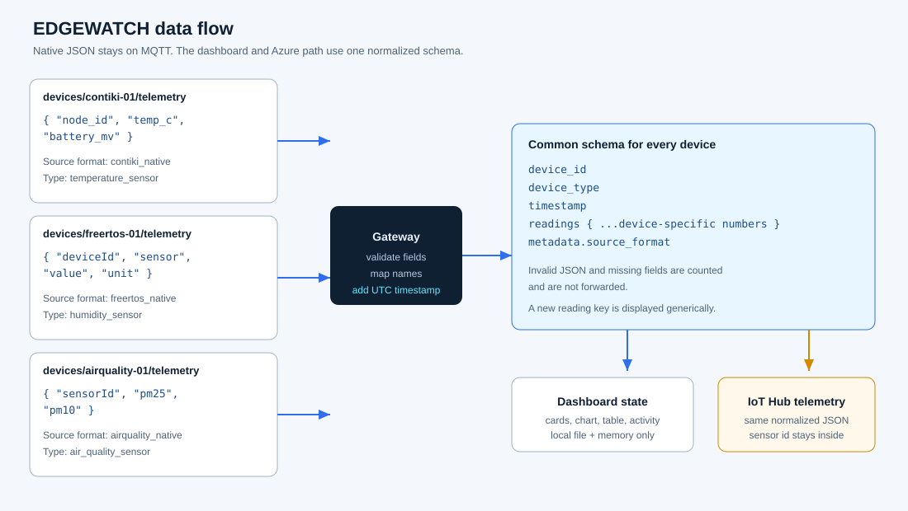
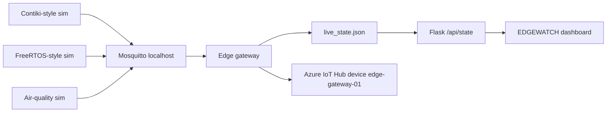

# EDGEWATCH architecture

EDGEWATCH is a local interoperability prototype. Python scripts stand in for devices that would run different embedded operating systems. They publish different JSON shapes to a localhost Mosquitto broker. One gateway maps those shapes into a common document, stores that document for the dashboard, and forwards a copy to Azure IoT Hub.

The dashboard never subscribes to MQTT and never reads telemetry back from Azure. Local reception and cloud forwarding are separate statuses.

## Components

| Piece | Role |
| --- | --- |
| `devices/contiki_sim.py` | Publishes Contiki-style `node_id`, `temp_c`, and `battery_mv`. |
| `devices/freertos_sim.py` | Publishes FreeRTOS-style `deviceId`, `sensor`, `value`, and `unit`. |
| `devices/airquality_sim.py` | Publishes `sensorId`, `pm25`, and `pm10` to show a third device. |
| Mosquitto on `127.0.0.1:1883` | Local MQTT broker. Not a substitute for IoT Hub. |
| `gateway/gateway.py` | Subscribes to `devices/+/telemetry`, validates, normalizes, records, forwards. |
| `gateway/normalizer.py` | The only place that understands native field names. |
| `gateway/azure_sender.py` | Azure IoT device SDK, or a clearly labeled mock sender. |
| `data/live_state.json` | Snapshot of in-memory gateway state. No database. |
| `dashboard/app.py` | Flask page and `GET /api/state`. |
| Browser UI | Polls the API every 2.5 seconds and renders normalized readings. |

## Data flow

The cloud arrow is one-way. A successful `send_message` return means the SDK accepted the call. It does not, by itself, prove that the IoT Hub portal has the message.

## Where edge processing happens

The gateway is the edge layer in this prototype. On the machine next to the broker it:

- rejects malformed JSON and incomplete payloads
- renames device-specific fields
- adds a UTC timestamp
- keeps a five-reading temperature average
- records processing time before the cloud call and the time spent inside the sender

It does not train a model, and it does not drop fields to claim a bandwidth saving.

## Adding a device

1. Add a small Python publisher with its own topic and native JSON.
2. Add a mapping branch in `gateway/normalizer.py` if the field names are new.
3. Restart the gateway.
4. Leave the dashboard files unchanged.

The UI builds cards, table cells, and extra charts from whatever numeric `readings` it receives.

## Latency definitions

- **Processing latency:** time from the start of handling one payload until the normalized message is stored, before the Azure call.
- **Forward latency:** time spent inside the sender call. Mock mode is in-process. Live mode is how long `IoTHubDeviceClient.send_message` blocked. It is not portal ingestion time.
- **Pipeline latency:** processing plus the forward call. This is still local. It is not a measured network round trip to Azure unless a live credential was used, and even then it ends when the SDK returns.
